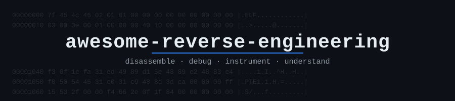

 

**A curated list of reverse engineering and binary analysis resources for practitioners, CTF players and malware analysts.**

This list covers tools, learning material and research for understanding software you do not have the source for. Everything here is defensive or educational: no malware samples, no weaponized tooling. Contributions are welcome, see [CONTRIBUTING.md](CONTRIBUTING.md).

## Contents

- [Disassemblers & Decompilers](#disassemblers--decompilers)
- [Debuggers](#debuggers)
- [Dynamic Instrumentation](#dynamic-instrumentation)
- [Binary Analysis Frameworks](#binary-analysis-frameworks)
- [Android / Mobile RE](#android--mobile-re)
- [iOS / macOS RE](#ios--macos-re)
- [Managed Code (.NET / Java)](#managed-code-net--java)
- [File / Format Analysis](#file--format-analysis)
- [Malware Analysis](#malware-analysis)
- [Deobfuscation / Unpacking](#deobfuscation--unpacking)
- [CTF Platforms & Wargames](#ctf-platforms--wargames)
- [Learning Resources](#learning-resources)
- [Books](#books)
- [Blogs & Writeups](#blogs--writeups)
- [Papers & Talks](#papers--talks)
- [Practice Binaries / Crackmes](#practice-binaries--crackmes)
- [Communities](#communities)

## Disassemblers & Decompilers

- [Binary Ninja](https://binary.ninja/) - Commercial interactive disassembler and decompiler with multiple IL levels and a rich Python API.
- [Compiler Explorer](https://godbolt.org/) - Compile snippets with many compilers and read the generated assembly; invaluable for learning compiler idioms.
- [Cutter](https://cutter.re/) - Free and open-source GUI for Rizin with a built-in decompiler.
- [Decompiler Explorer](https://dogbolt.org/) - Run one binary through many decompilers and compare the output side by side.
- [Ghidra](https://ghidra-sre.org/) - NSA's open-source software reverse engineering suite with a powerful decompiler.
- [Hopper](https://www.hopperapp.com/) - Disassembler and decompiler for macOS and Linux with strong Objective-C support.
- [IDA Free](https://hex-rays.com/ida-free/) - Free edition of the industry-standard interactive disassembler and decompiler.
- [radare2](https://rada.re/n/radare2.html) - Scriptable, command-line-driven reverse engineering framework.
- [Reko](https://github.com/uxmal/reko) - Open-source decompiler for machine code, with a focus on older architectures.
- [RetDec](https://github.com/avast/retdec) - Retargetable machine-code decompiler based on LLVM.
- [Rizin](https://rizin.re/) - Fork of radare2 focused on a stable, user-friendly UX and API.

## Debuggers

- [GDB](https://www.sourceware.org/gdb/) - The GNU debugger, the baseline for native debugging on Linux and beyond.
- [GEF](https://github.com/hugsy/gef) - Modern GDB enhanced features for exploit developers and reverse engineers.
- [LLDB](https://lldb.llvm.org/) - LLVM's debugger and the default on macOS and iOS.
- [pwndbg](https://github.com/pwndbg/pwndbg) - GDB and LLDB plug-in that makes debugging and exploit development less painful.
- [rr](https://rr-project.org/) - Record and replay debugger for Linux with reverse execution.
- [Time Travel Debugging](https://learn.microsoft.com/en-us/windows-hardware/drivers/debuggercmds/time-travel-debugging-overview) - Record a Windows process trace and replay it forwards and backwards in WinDbg.
- [WinDbg](https://learn.microsoft.com/en-us/windows-hardware/drivers/debugger/) - Microsoft's debugger for user mode, kernel mode and crash dump analysis.
- [x64dbg](https://x64dbg.com/) - Open-source user-mode debugger for Windows, the go-to for malware and crackme work.

## Dynamic Instrumentation

- [DynamoRIO](https://dynamorio.org/) - Runtime code manipulation system for building custom dynamic analysis tools.
- [Frida](https://frida.re/) - Dynamic instrumentation toolkit that injects JavaScript into native apps on every major platform.
- [Intel Pin](https://www.intel.com/content/www/us/en/developer/articles/tool/pin-a-dynamic-binary-instrumentation-tool.html) - Dynamic binary instrumentation framework for building analysis tools.
- [QBDI](https://qbdi.quarkslab.com/) - Modular, cross-platform dynamic binary instrumentation framework by Quarkslab.
- [Qiling](https://qiling.io/) - Binary emulation framework that can run and instrument executables from many OSes and architectures.
- [TinyInst](https://github.com/googleprojectzero/TinyInst) - Lightweight, small-footprint dynamic instrumentation library from Google Project Zero.
- [Valgrind](https://valgrind.org/) - Instrumentation framework for memory debugging and profiling tools.

## Binary Analysis Frameworks

- [angr](https://angr.io/) - Python framework for binary analysis combining static analysis and symbolic execution.
- [BAP](https://github.com/BinaryAnalysisPlatform/bap) - Binary Analysis Platform, a lifting and analysis infrastructure from CMU.
- [Capstone](https://www.capstone-engine.org/) - Lightweight multi-architecture disassembly framework.
- [Keystone](https://www.keystone-engine.org/) - Multi-architecture assembler framework.
- [LIEF](https://lief-project.github.io/) - Library to parse, modify and abstract ELF, PE and Mach-O formats.
- [Miasm](https://github.com/cea-sec/miasm) - Python reverse engineering framework with lifting, emulation and symbolic execution.
- [pwntools](https://docs.pwntools.com/) - CTF framework and exploit development library for Python.
- [Triton](https://triton-library.github.io/) - Dynamic binary analysis library with symbolic execution and taint analysis.
- [Unicorn](https://www.unicorn-engine.org/) - Lightweight multi-architecture CPU emulator framework.
- [Z3](https://github.com/Z3Prover/z3) - SMT solver widely used to solve constraints extracted from binaries.

## Android / Mobile RE

- [Androguard](https://github.com/androguard/androguard) - Python tools to disassemble, decompile and analyze Android apps.
- [apktool](https://apktool.org/) - Decode resources and rebuild Android APKs, with smali disassembly.
- [Bytecode Viewer](https://bytecodeviewer.com/) - Java and Android bytecode viewer with multiple decompilers in one GUI.
- [dex2jar](https://github.com/pxb1988/dex2jar) - Convert Dalvik `.dex` files to Java `.class` files.
- [Frida](https://frida.re/) - Hook Android and iOS apps at runtime from JavaScript or Python.
- [Ghidra](https://ghidra-sre.org/) - Handles Dalvik and native ARM libraries inside Android apps.
- [jadx](https://github.com/skylot/jadx) - Dex to Java decompiler with a GUI and command-line interface.
- [MobSF](https://mobsf.github.io/docs/) - Automated static and dynamic mobile app analysis framework.
- [objection](https://github.com/sensepost/objection) - Runtime mobile exploration toolkit powered by Frida.
- [OWASP MASTG](https://mas.owasp.org/MASTG/) - Mobile Application Security Testing Guide with extensive reverse engineering techniques.

## iOS / macOS RE

- [class-dump](https://github.com/nygard/class-dump) - Generate Objective-C headers from Mach-O binaries.
- [dsdump](https://github.com/DerekSelander/dsdump) - Improved class-dump and nm for Objective-C and Swift.
- [Frida](https://frida.re/) - Instrument iOS and macOS processes on jailbroken and non-jailbroken devices.
- [Hopper](https://www.hopperapp.com/) - Excellent Objective-C and Swift awareness for Apple platform binaries.
- [ipsw](https://github.com/blacktop/ipsw) - Research tool for downloading, parsing and diffing iOS and macOS firmware.
- [MachOView](https://github.com/gdbinit/MachOView) - Visual browser for the structure of Mach-O files.
- [Objective-See](https://objective-see.org/) - Free macOS security tools and research, many of them open source.
- [The Apple Wiki](https://theapplewiki.com/) - Community documentation of Apple firmware, keys and internals.

## Managed Code (.NET / Java)

- [CFR](https://www.benf.org/other/cfr/) - Java decompiler that handles modern language features well.
- [dnSpyEx](https://github.com/dnSpyEx/dnSpy) - Maintained fork of dnSpy: .NET debugger, decompiler and assembly editor.
- [dotPeek](https://www.jetbrains.com/decompiler/) - Free .NET decompiler from JetBrains.
- [ILSpy](https://github.com/icsharpcode/ILSpy) - Open-source .NET assembly browser and decompiler.
- [JD-GUI](https://java-decompiler.github.io/) - Standalone graphical Java decompiler.
- [Recaf](https://github.com/Col-E/Recaf) - Modern Java bytecode editor and analysis tool.
- [Vineflower](https://github.com/Vineflower/vineflower) - Modern, actively maintained fork of the Fernflower Java decompiler.

## File / Format Analysis

- [010 Editor](https://www.sweetscape.com/010editor/) - Hex editor with binary templates for parsing structured formats.
- [binwalk](https://github.com/ReFirmLabs/binwalk) - Firmware analysis tool for finding and extracting embedded files.
- [CFF Explorer](https://ntcore.com/explorer-suite/) - PE editor included in the Explorer Suite.
- [Detect It Easy](https://github.com/horsicq/Detect-It-Easy) - Identify compilers, packers and file types with a signature-based engine.
- [ImHex](https://imhex.werwolv.net/) - Feature-rich hex editor with a pattern language and data inspector.
- [Kaitai Struct](https://kaitai.io/) - Declarative language to describe and parse binary formats.
- [PE Format](https://learn.microsoft.com/en-us/windows/win32/debug/pe-format) - Official Microsoft specification of the Portable Executable format.
- [PE-bear](https://github.com/hasherezade/pe-bear) - Multiplatform reversing tool for PE files.
- [PEStudio](https://www.winitor.com/) - Static inspection of Windows executables for suspicious indicators.
- [Sysinternals](https://learn.microsoft.com/en-us/sysinternals/) - Microsoft's suite of Windows system utilities, including Process Monitor and Process Explorer.
- [unblob](https://github.com/onekey-sec/unblob) - Extraction suite for firmware images and nested container formats.

## Malware Analysis

Analysis tools and references only; no samples.

- [ANY.RUN](https://any.run/) - Interactive online malware sandbox.
- [capa](https://github.com/mandiant/capa) - Identify capabilities in executable files using rules mapped to MITRE ATT&CK.
- [CAPE Sandbox](https://github.com/kevoreilly/CAPEv2) - Malware sandbox focused on payload extraction and configuration dumping.
- [Cuckoo3](https://github.com/cert-ee/cuckoo3) - Open-source automated malware analysis system, the successor to Cuckoo Sandbox.
- [Didier Stevens Suite](https://blog.didierstevens.com/didier-stevens-suite/) - Collection of small, focused tools for analyzing documents and malware artifacts.
- [FLARE VM](https://github.com/mandiant/flare-vm) - Windows-based malware analysis distribution installable on a fresh VM.
- [FLOSS](https://github.com/mandiant/flare-floss) - Automatically extract obfuscated strings from malware.
- [Hybrid Analysis](https://www.hybrid-analysis.com/) - Free online malware analysis service.
- [Malpedia](https://malpedia.caad.fkie.fraunhofer.de/) - Curated encyclopedia of malware families and references.
- [MITRE ATT&CK](https://attack.mitre.org/) - Knowledge base of adversary tactics and techniques.
- [oletools](https://github.com/decalage2/oletools) - Analyze Microsoft Office files and detect malicious macros.
- [REMnux](https://remnux.org/) - Linux toolkit for reverse engineering and analyzing malware.
- [Triage](https://tria.ge/) - Malware sandbox with behavioral reports and config extraction.
- [VirusTotal](https://www.virustotal.com/) - Multi-engine file and URL scanning with extensive community context.
- [Volatility 3](https://github.com/volatilityfoundation/volatility3) - Memory forensics framework.
- [Wireshark](https://www.wireshark.org/) - Network protocol analyzer used to study malware communication.
- [YARA](https://virustotal.github.io/yara/) - Pattern matching language for identifying and classifying malware.

## Deobfuscation / Unpacking

- [Anti-Debug Tricks](https://anti-debug.checkpoint.com/) - Check Point's reference of anti-debugging techniques and how to detect them.
- [Binary Refinery](https://github.com/binref/refinery) - Toolkit of composable command-line units for transforming and decoding data.
- [d810](https://github.com/joydo/d810) - IDA Pro plugin for deobfuscating control-flow flattening and opaque predicates.
- [de4dot](https://github.com/de4dot/de4dot) - .NET deobfuscator and unpacker.
- [HollowsHunter](https://github.com/hasherezade/hollows_hunter) - Scan running processes for implants and dump them.
- [OALabs Research](https://research.openanalysis.net/) - Tutorials on unpacking and configuration extraction.
- [PE-sieve](https://github.com/hasherezade/pe-sieve) - Detect and dump hollowed, injected or replaced PE modules in memory.
- [Quarkslab: Deobfuscation of an OLLVM-protected program](https://blog.quarkslab.com/deobfuscation-recovering-an-ollvm-protected-program.html) - Step-by-step recovery of a program protected by Obfuscator-LLVM.
- [Scylla](https://github.com/NtQuery/Scylla) - Import reconstruction and process dumping, bundled with x64dbg.
- [Tigress](https://tigress.wtf/) - Source-to-source C obfuscator for studying and evaluating deobfuscation techniques.
- [UnpacMe](https://www.unpac.me/) - Automated malware unpacking service.

## CTF Platforms & Wargames

- [crackmes.one](https://crackmes.one/) - Community-submitted crackme challenges of all difficulty levels.
- [CTFtime](https://ctftime.org/) - Calendar, team rankings and writeups for CTF competitions worldwide.
- [Exploit Education](https://exploit.education/) - Virtual machines and challenges for learning memory corruption and reversing.
- [Flare-On](https://flare-on.com/) - Annual reverse engineering challenge from Mandiant's FLARE team.
- [Hack The Box](https://www.hackthebox.com/) - Hands-on labs and challenges, including a reversing category.
- [microcorruption](https://microcorruption.com/) - Embedded security CTF where you debug an MSP430 lock.
- [OverTheWire](https://overthewire.org/wargames/) - Classic wargames for learning security concepts.
- [picoCTF](https://picoctf.org/) - Beginner-friendly CTF platform from Carnegie Mellon University.
- [pwn.college](https://pwn.college/) - Arizona State University's free, belt-based course and challenge platform.
- [pwnable.tw](https://pwnable.tw/) - Wargame site focused on binary exploitation.
- [Ret2 Wargames](https://wargames.ret2.systems/) - Browser-based binary exploitation and reversing wargames.
- [Root Me](https://www.root-me.org/) - Large catalog of challenges with a cracking and reversing category.
- [ROP Emporium](https://ropemporium.com/) - Learn return-oriented programming through focused challenges.

## Learning Resources

- [Azeria Labs: Writing ARM Assembly](https://azeria-labs.com/writing-arm-assembly-part-1/) - Introductory ARM assembly tutorial series.
- [Felix Cloutier x86 reference](https://www.felixcloutier.com/x86/) - Searchable x86 and x86-64 instruction reference derived from the Intel manuals.
- [Intel SDM](https://www.intel.com/content/www/us/en/developer/articles/technical/intel-sdm.html) - The authoritative x86-64 architecture manuals.
- [LiveOverflow](https://www.youtube.com/@LiveOverflow) - Video series on binary exploitation and reverse engineering.
- [Malware Unicorn: RE101](https://malwareunicorn.org/workshops/re101.html) - Free self-paced introduction to reverse engineering malware.
- [Modern Binary Exploitation](https://github.com/RPISEC/MBE) - RPISEC's university course material with lectures and labs.
- [Nightmare](https://guyinatuxedo.github.io/) - Intro to binary exploitation and reverse engineering with CTF-based examples.
- [Open Security Training](https://opensecuritytraining.info/) - Free classes on x86, reverse engineering and internals.
- [Reverse Engineering for Beginners](https://beginners.re/) - Free book and course material by Dennis Yurichev.
- [x86 Assembly Guide](https://www.cs.virginia.edu/~evans/cs216/guides/x86.html) - Short, clear intro to 32-bit x86 from the University of Virginia.

## Books

- [Computer Systems: A Programmer's Perspective](https://csapp.cs.cmu.edu/) - Randal E. Bryant and David R. O'Hallaron. Machine-level representation of programs and linking.
- [Hacking: The Art of Exploitation](https://nostarch.com/hacking2.htm) - Jon Erickson. Assembly, memory and exploitation fundamentals.
- [Practical Binary Analysis](https://nostarch.com/binaryanalysis) - Dennis Andriesse. Build your own analysis tools with disassembly, instrumentation and symbolic execution.
- [Practical Malware Analysis](https://nostarch.com/malware) - Michael Sikorski and Andrew Honig. The standard hands-on introduction to malware analysis.
- [Reverse Engineering for Beginners](https://beginners.re/) - Dennis Yurichev. Free, comprehensive guide to assembly and compiler output.
- [The Art of Mac Malware](https://taomm.org/) - Patrick Wardle. Free analysis-focused guide to macOS threats.
- [The Ghidra Book](https://nostarch.com/ghidra-book-2e) - Chris Eagle and Kara Nance. The definitive guide to Ghidra.
- [The IDA Pro Book](https://nostarch.com/idapro2.htm) - Chris Eagle. The unofficial guide to the world's most popular disassembler.
- [Windows Internals](https://learn.microsoft.com/en-us/sysinternals/resources/windows-internals) - Pavel Yosifovich, Alex Ionescu, Mark Russinovich and David Solomon. Deep reference on how Windows works.

## Blogs & Writeups

- [0xdf hacks stuff](https://0xdf.gitlab.io/) - Detailed Hack The Box and CTF writeups.
- [Check Point Research](https://research.checkpoint.com/) - Threat research and reverse engineering deep dives.
- [Cisco Talos](https://blog.talosintelligence.com/) - Threat intelligence and vulnerability research.
- [Elastic Security Labs](https://www.elastic.co/security-labs) - Malware analysis and detection engineering research.
- [Google Project Zero](https://googleprojectzero.blogspot.com/) - Vulnerability research with extensive reverse engineering detail.
- [Hasherezade's Blog](https://hshrzd.wordpress.com/) - Windows internals, malware and tool development.
- [Hex-Rays Blog](https://hex-rays.com/blog) - Tips and news from the makers of IDA.
- [Möbius Strip Reverse Engineering](https://www.msreverseengineering.com/blog) - Rolf Rolles on program analysis and deobfuscation.
- [Objective-See Blog](https://objective-see.org/blog.html) - macOS malware analysis and tool releases.
- [Phrack](https://phrack.org/) - Long-running hacker e-zine with technical papers.
- [Quarkslab Blog](https://blog.quarkslab.com/) - Reverse engineering, obfuscation and binary analysis research.
- [Ret2 Systems Blog](https://blog.ret2.io/) - Vulnerability research and binary analysis tooling.
- [Secret Club](https://secret.club/) - Low-level reversing and Windows research.
- [Securelist](https://securelist.com/) - Kaspersky's threat research.
- [SentinelLabs](https://www.sentinelone.com/labs/) - Malware and threat actor analysis.
- [The Old New Thing](https://devblogs.microsoft.com/oldnewthing/) - Raymond Chen on Windows history and internals.
- [Trail of Bits Blog](https://blog.trailofbits.com/) - Program analysis, tooling and security research.
- [Unit 42](https://unit42.paloaltonetworks.com/) - Palo Alto Networks threat research.

## Papers & Talks

- [A Survey of Binary Code Similarity](https://arxiv.org/abs/1909.06118) - Haq and Caballero. Overview of techniques for comparing binaries.
- [Driller: Augmenting Fuzzing Through Selective Symbolic Execution](https://www.ndss-symposium.org/wp-content/uploads/2017/09/driller-augmenting-fuzzing-through-selective-symbolic-execution.pdf) - Combines fuzzing with concolic execution, built on angr.
- [REcon](https://recon.cx/) - Conference dedicated to reverse engineering, with archived talks.
- [SoK: (State of) The Art of War](https://sites.cs.ucsb.edu/~vigna/publications/2016_SP_angrSoK.pdf) - The angr paper surveying offensive binary analysis techniques.
- [Valgrind: A Framework for Heavyweight Dynamic Binary Instrumentation](https://valgrind.org/docs/valgrind2007.pdf) - The PLDI 2007 paper behind Valgrind.
- [Virus Bulletin Conference](https://www.virusbulletin.com/conference/) - Papers and recordings on malware analysis and threat research.

## Practice Binaries / Crackmes

- [angr examples](https://github.com/angr/angr-examples) - Worked CTF challenges solved with angr, with binaries.
- [crackmes.one](https://crackmes.one/) - Thousands of community crackmes sorted by language and difficulty.
- [Flare-On Challenges](https://flare-on.com/) - Past years' challenges are archived and fully solvable.
- [Modern Binary Exploitation labs](https://github.com/RPISEC/MBE) - Labs with binaries to reverse and exploit locally.
- [Reverse Engineering Challenges](https://challenges.re/) - Exercises by Dennis Yurichev to accompany his book.
- [RingZer0 CTF](https://ringzer0ctf.com/) - Challenges including a reversing track.
- [Root Me Cracking](https://www.root-me.org/en/Challenges/Cracking/) - Graded cracking and reverse engineering challenges.

## Communities

- [0x00sec](https://0x00sec.org/) - Community for hands-on security and reverse engineering learning.
- [Ghidra Discussions](https://github.com/NationalSecurityAgency/ghidra/discussions) - Official place to ask Ghidra questions and share scripts.
- [Hex-Rays Forum](https://forum.hex-rays.com/) - Official IDA support and community forum.
- [r/Malware](https://www.reddit.com/r/Malware/) - Subreddit for malware analysis discussion.
- [r/ReverseEngineering](https://www.reddit.com/r/ReverseEngineering/) - Subreddit for high-quality RE news and research.
- [Reverse Engineering Stack Exchange](https://reverseengineering.stackexchange.com/) - Q&A for reverse engineering questions.
- [Tuts4You](https://forum.tuts4you.com/) - Long-running forum covering unpacking, tools and tutorials.

## License

To the extent possible under law, the contributors have waived all copyright and related or neighboring rights to this work.
# awesome-reverse-engineering

